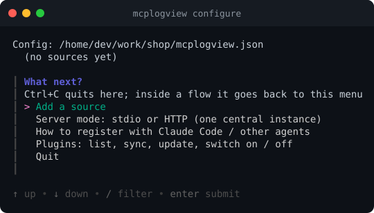

# mcplogview

An [MCP](https://modelcontextprotocol.io) server that lets AI agents read your logs: **local files, files on
remote hosts over SSH, and Docker container logs**. One static binary, set up with an interactive wizard.



## Install

```bash
# Linux and macOS: download the release binary (checksum-verified) into ~/.local/bin
curl -fsSL https://raw.githubusercontent.com/skromesch/mcplogview-go/main/install.sh | sh

brew install --cask skromesch/tap/mcplogview      # Homebrew, once a release is published
go install github.com/skromesch/mcplogview-go/cmd/mcplogview@latest
```

Options of the script (`--version v0.1.0`, `--dir /usr/local/bin`) are in [Getting started](docs/getting-started.md#1-install).

## Quick start

```bash
cd ~/work/myproject
mcplogview configure                  # browse to a log file or pick a Docker container
claude mcp add mcplogview -- mcplogview
```

Then ask your agent: *"list my logs and show me the recent errors."*
Details: **[Getting started](docs/getting-started.md)**.

## Documentation

| | |
|---|---|
| [Getting started](docs/getting-started.md) | install, first source, connect an agent |
| [Interactive setup](docs/interactive-setup.md) | `mcplogview configure`, screen by screen |
| [Configuration reference](docs/configuration.md) | every config key, default and path rule |
| [Log sources](docs/sources.md) | local files, SSH, Docker; switching sources on and off |
| [Command reference](docs/cli.md) | all commands, flags, environment variables, exit codes |
| [HTTP mode](docs/http-mode.md) | one central instance for many agents, with a token |
| [Running in Docker](docs/docker.md) | `docker compose up` for that instance, hardened, with a Docker-log proxy |
| [Using it with agents](docs/using-with-agents.md) | the four tools, cursors, per-source skills |
| [Lua plugins](docs/plugins.md) | sandboxed Lua plugins: custom source trees, tools and hooks |
| [Troubleshooting](docs/troubleshooting.md) | common errors and fixes |

## At a glance

- **Sources:** `local` file, `ssh` file, `docker` container (local or on a remote host over SSH).
- **Switch sources on/off** (`mcplogview disable prod-api`) and a running server picks it up within seconds.
- **Docker:** `docker compose up -d --build` runs a hardened central instance ([docs](docs/docker.md)).
- **stdio** by default (each agent starts its own process), or **Streamable HTTP** for one shared instance,
  protected by a bearer token.
- **Config lookup:** `--config`, `$LOG_SOURCES_CONFIG`, `./mcplogview.json`, `~/.config/mcplogview/config.json`.
- **Plugins:** optional, admin-installed Lua plugins add source trees, tools and hooks ([docs](docs/plugins.md)).
- **Plugin tooling:** `mcplogview plugin sync` installs plugins from git with a lock file, `plugin test` runs their Lua tests ([docs](docs/plugins.md#installing-plugins-from-git)).
- **Tools for agents:** `list_logs`, `get_log_skill`, `read_log_chunk`, `follow_log`.

## Development

```bash
go test -race ./...
go build -o mcplogview ./cmd/mcplogview
```

The documentation screenshots are generated from the real program: see [docs/screenshots](docs/screenshots/).

Releases: push a `v*` tag; GoReleaser builds the archives and updates the Homebrew tap
(needs the `HOMEBREW_TAP_TOKEN` repository secret).
