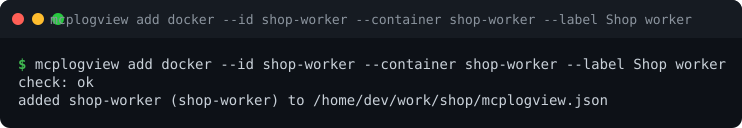

# Command reference

```text
mcplogview                       show help (when run in a terminal)
mcplogview serve                 run the MCP server
mcplogview configure             interactive setup
mcplogview add local|ssh|docker  add a source
mcplogview list                  show the effective sources
mcplogview enable|disable        switch sources on/off
mcplogview remove                delete a source
mcplogview check                 test sources
mcplogview transport             show/change stdio or HTTP mode
mcplogview register              show/run the agent registration
mcplogview plugin                sync | list | remove | test (Lua plugins)
mcplogview init | where | version
```


Run with **no arguments in a terminal** it prints this help. When an agent starts it (stdin is a pipe) the same
command starts the server. Use `serve` to start the server explicitly, e.g. for HTTP mode.

Almost every command accepts `--config FILE` and then works on that file; otherwise the
[usual lookup](configuration.md#which-file-is-used) applies. Commands that **change** the config edit the file found by that
lookup, or create `./mcplogview.json` if there is none.

## `serve`

```
mcplogview serve [--config FILE]
```

Starts the server using the transport from the config (stdio by default). Diagnostics go to stderr and to the
self-log, never to stdout in stdio mode.


A running server re-reads sources every few seconds, so `enable`, `disable`, `add` and `remove` take effect without a
restart. Stop it with Ctrl+C or SIGTERM.

## `configure`

```
mcplogview configure [--config FILE] [--plain]
```

The interactive editor, see [Interactive setup](interactive-setup.md). `--plain` (or `MCPLOGVIEW_PLAIN=1`, or
`TERM=dumb`, or a non-terminal stdin) uses simple numbered prompts.

## `add`

```
mcplogview add local  --id ID --path FILE
mcplogview add ssh    --id ID --host H --user U --identity-file KEY --path REMOTE_FILE
mcplogview add docker --id ID --container NAME [--host H [--user U] [--identity-file KEY]]
```

| Flag | Applies to | |
|------|------------|--|
| `--id` | all | required, unique |
| `--label` | all | default: the id |
| `--description`, `--hint` | all | optional text for the agent |
| `--path` | local, ssh | the log file |
| `--container` | docker | container name |
| `--host`, `--user`, `--identity-file`, `--port` | ssh, docker | SSH connection (required for ssh; optional for docker) |
| `--strict-host-key-checking` | ssh, docker | verify the host key |
| `--no-check` | all | save without testing first |
| `--config FILE` | all | file to edit |

`add` **tests the source before saving** and refuses to save one that is not reachable, unless `--no-check`.
Relative local paths are stored as absolute paths.



## `list`

```
mcplogview list [--config FILE]        (alias: ls)
```

Prints id, state (`on`/`off`), type, label and location of every source.


## `enable`, `disable`

```
mcplogview enable  ID... | --all [--config FILE]        (alias: on)
mcplogview disable ID... | --all [--config FILE]        (alias: off)
```

Switches sources on or off without deleting them. Disabled sources are invisible to agents.

## `remove`

```
mcplogview remove ID [--config FILE]                    (alias: rm)
```

## `check`

```
mcplogview check [ID...] [--config FILE]
```

Tests that sources are reachable and readable. Without ids it checks every enabled source; naming an id tests it
even if it is switched off. Exit code 1 if any check fails.


## `transport`

```
mcplogview transport [--mode stdio|http|https-dev] [--host H] [--port N] [--path P]
                     [--new-token | --no-token] [--allow-no-auth] [--show-token]
```

Without options it shows the current settings. With options it changes them. Switching to `http` or `https-dev`
generates a token if there is none; exposing a non-loopback address without a token is refused. Details and
security notes: [HTTP mode](http-mode.md).


## `register`

```
mcplogview register [--run] [--config FILE]
```

Prints how to register this server with Claude Code and other MCP clients, for your current mode (stdio command
or HTTP URL with the token header). `--run` runs `claude mcp add` instead of printing it.


## `plugin`

```
mcplogview plugin sync [--update] [NAME...] [--config FILE]
mcplogview plugin list [--config FILE]
mcplogview plugin remove NAME [--config FILE]
mcplogview plugin test [-run REGEXP] DIR
```

`sync` installs the [plugins with a `git` URL](plugins.md#installing-plugins-from-git) and pins their commits in
`plugins.lock.json` (`--update` moves to the latest of `ref`); `list` (alias `ls`) shows install states and whether
each plugin loads; `remove` (alias `rm`) deletes an installed clone but not its config entry. `test` runs
`DIR/tests/*_test.lua` (see [Testing plugins](plugins.md#testing-plugins)) and needs no config; exit code 1 if a
case fails.

## `init`, `where`, `version`

```
mcplogview init [--force]      write an example ./mcplogview.json (it has placeholder sources: edit or `remove` them)
mcplogview where               which config file is in effect, and why
mcplogview version
```

## Environment variables

| Variable | Effect |
|----------|--------|
| `LOG_SOURCES_CONFIG` | config file path (after `--config`, before `./mcplogview.json`) |
| `MCPLOGVIEW_TOKEN` | HTTP auth token; overrides `transport.authToken` |
| `MCPLOGVIEW_BROWSE_DIR` | where the wizard's local file browser starts (default `/var/log`) |
| `MCPLOGVIEW_PLAIN` | any value: use plain numbered prompts in `configure` |
| `XDG_CONFIG_HOME` | base of the user-wide config (`$XDG_CONFIG_HOME/mcplogview/config.json`) |
| `XDG_STATE_HOME` | base of the default self-log (`$XDG_STATE_HOME/mcplogview/`) |

## Exit codes

| Code | Meaning |
|------|---------|
| 0 | success |
| 1 | the operation failed (unreachable source, bad config, port in use, ...) |
| 2 | wrong usage (unknown command, missing or invalid flags) |
| 130 | `configure` was aborted with Ctrl+C |
