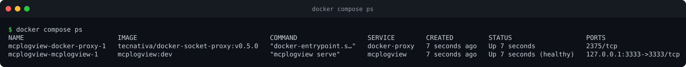
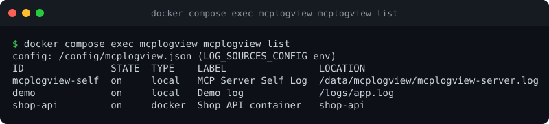
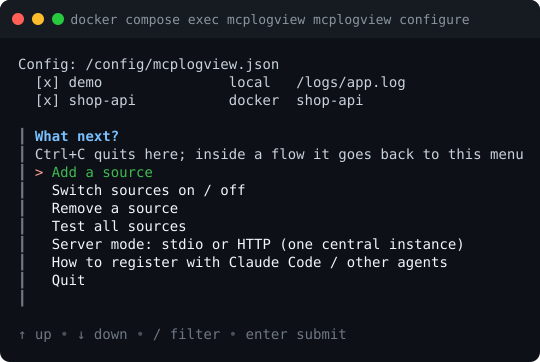

# Running in Docker (central HTTP instance)

The repository ships a `Dockerfile` and a `compose.yaml` that run mcplogview as **one central HTTP instance**
(see [HTTP mode](http-mode.md) for what that means). A bearer token is mandatory, and the container is locked down
(non-root, read-only filesystem, no capabilities).

```
   agents ──HTTP + token──▶ ┌─────────────────────────────┐
  (Claude Code, Inspector)  │ mcplogview  (container)     │
                            │  /logs   ◀── bind mount (ro)│── local files
                            │  /config ◀── bind mount     │── mcplogview.json, log-skills/
                            │  ~/.ssh/keys  ◀── mount (ro)│── ssh keys ──▶ remote hosts (ssh sources)
                            │  ~/.ssh/known_hosts (rw)    │
                            └──────────┬──────────────────┘
                                       │ DOCKER_HOST=tcp://docker-proxy:2375   (optional profile "docker")
                            ┌──────────▼──────────────────┐
                            │ docker-proxy (read-only API)│── /var/run/docker.sock ──▶ container logs
                            └─────────────────────────────┘
```

## Quick start

```bash
git clone https://github.com/skromesch/mcplogview-go && cd mcplogview-go
cp .env.example .env
$EDITOR .env                          # set MCPLOGVIEW_TOKEN, e.g. from: openssl rand -base64 24
docker compose up -d --build
```

The server now listens on `http://127.0.0.1:3333/mcp` (loopback only) and serves the sample log from
`deploy/docker/logs/app.log`. Check it:

```bash
docker compose ps                                   # the mcplogview service should be "healthy"
docker compose exec mcplogview mcplogview list      # the sources it serves
```





Connect Claude Code (use the token from your `.env`):

```bash
claude mcp add --transport http mcplogview http://127.0.0.1:3333/mcp \
    --header "Authorization: Bearer <token>"
```

To also read **Docker container logs**, start with the `docker` profile (it adds the read-only
[socket proxy](#docker-sources)):

```bash
docker compose --profile docker up -d --build
```

## What is in the repository

| File | Purpose |
|------|---------|
| [`Dockerfile`](../Dockerfile) | multi-stage build: Go binary into a small Alpine image with the `ssh` and `docker` clients |
| [`compose.yaml`](../compose.yaml) | the `mcplogview` service, and the optional `docker-proxy` (profile `docker`) |
| [`.env.example`](../.env.example) | settings, copied to `.env` (never committed) |
| `deploy/docker/config/mcplogview.json` | the config the container uses (mounted at `/config`) |
| `deploy/docker/logs/` | sample logs (mounted read-only at `/logs`) |
| `deploy/docker/ssh/keys/` | put ssh private keys here for `ssh` sources (mounted read-only; its contents are git-ignored) |
| `deploy/docker/ssh/known_hosts` | trusted host keys for `ssh` sources (a file, mounted writable; must exist) |
| [`deploy/docker/smoke.sh`](../deploy/docker/smoke.sh) | end-to-end test of the whole setup (see [Testing](#testing-the-setup)) |

## Settings (`.env`)

| Variable | Default | Meaning |
|----------|---------|---------|
| `MCPLOGVIEW_TOKEN` | **required** | the bearer token clients must send (min. 16 characters). Compose refuses to start without it |
| `MCPLOGVIEW_BIND` | `127.0.0.1` | host address the port is published on. `0.0.0.0` serves the network; read [Security](#security) first |
| `MCPLOGVIEW_PORT` | `3333` | host port |
| `MCPLOGVIEW_LOGS` | `./deploy/docker/logs` | host directory exposed read-only as `/logs` |
| `MCPLOGVIEW_CONFIG` | `./deploy/docker/config` | host directory with `mcplogview.json` (and `log-skills/`), mounted at `/config` |
| `MCPLOGVIEW_SSH_KEYS` | `./deploy/docker/ssh/keys` | host directory with ssh private keys, mounted read-only as `/home/mcplogview/.ssh/keys` |
| `MCPLOGVIEW_KNOWN_HOSTS` | `./deploy/docker/ssh/known_hosts` | host **file** with trusted host keys, mounted writable as `/home/mcplogview/.ssh/known_hosts`. It must exist: if it does not, Docker creates a *directory* of that name |
| `MCPLOGVIEW_UID` | `10001` | uid of the user inside the image (a build argument), see [Linux file permissions](#linux-file-permissions) |
| `MCPLOGVIEW_VERSION` | `dev` | version stamped into the binary and the image tag |

## Choosing what is exposed

Everything the container can read is a possible source. Add sources by editing
`deploy/docker/config/mcplogview.json` on the host, or from inside the container (next section). Source paths are
**paths inside the container**.

### Local files

Mount the host directory (read-only) and point sources at the container path:

```bash
# .env
MCPLOGVIEW_LOGS=/var/log/myapp
```

```json
{ "id": "app", "label": "App log", "path": "/logs/app.log" }
```

To expose several directories add more `volumes:` entries to `compose.yaml`, for example
`- /var/log/nginx:/logs/nginx:ro`.

### SSH sources

Three mounts are involved (the keys are read-only inside the container):

| What | Host (default) | In the container |
|---|---|---|
| private keys | `deploy/docker/ssh/keys/` | `~/.ssh/keys/` |
| trusted host keys | `deploy/docker/ssh/known_hosts` (a file, writable) | `~/.ssh/known_hosts` |
| config | `deploy/docker/config/` (`mcplogview.json`, `log-skills/`) | `/config/` |

The config is mounted as a **directory**, not as the single file: `configure` and `add` replace the file atomically,
which a single-file bind mount does not allow, and the server's live reload watches that file.

Put a key (**without a passphrase**; mcplogview never prompts) and the host's key in place:

```bash
cp ~/.ssh/id_ed25519 deploy/docker/ssh/keys/ && chmod 600 deploy/docker/ssh/keys/id_ed25519
ssh-keyscan -t ed25519 prod-api.example.com >> deploy/docker/ssh/known_hosts
```

```bash
docker compose exec mcplogview mcplogview add ssh --id prod-api --host prod-api.example.com \
    --user ubuntu --identity-file '~/.ssh/keys/id_ed25519' --path /var/log/myapp/api.log
```

- A dedicated key that is only allowed to read logs is better than your personal key.
- `known_hosts` is writable on purpose: on the first connection to a host `ssh` records its key there, so it
  persists across restarts and later connections verify it. Pre-fill it with `ssh-keyscan` (above) to trust only
  hosts you checked, and set `"strictHostKeyChecking": true` on the source to refuse any host that is not listed.
  The container user must be able to write the file (on Linux: build with `MCPLOGVIEW_UID=$(id -u)`, see below).
- To keep keys and `known_hosts` out of the repository, point `MCPLOGVIEW_SSH_KEYS` and `MCPLOGVIEW_KNOWN_HOSTS`
  at files elsewhere in `.env`.
- `~/.ssh/config` aliases are not available in the container.

A **Docker container on a remote host** is an ssh source variant (`mcplogview add docker --host ...`); it needs the
`docker` CLI on that host, not in this image.

### Docker sources

Reading the logs of containers on the host needs the Docker API. The compose file does **not** give mcplogview the
Docker socket (that is effectively root on the host). Instead the `docker` profile starts
[`docker-socket-proxy`](https://github.com/Tecnativa/docker-socket-proxy), a small proxy in front of the socket that
allows only **read** access to the container endpoints (`CONTAINERS=1`, `POST=0`). mcplogview talks to it through
`DOCKER_HOST=tcp://docker-proxy:2375`.

```bash
docker compose --profile docker up -d --build
docker compose exec mcplogview mcplogview add docker --id shop-api --container shop-api
```

Verified by the smoke test: through the proxy `docker logs` and `docker ps` work, while `docker stop`, `docker exec` and
`docker run` are answered with `403 Forbidden`.

Without `--profile docker`, `docker` sources simply fail with a clear connection error; nothing else is affected.

*Alternative: mount the socket directly.* Only if you accept that anyone who can talk to mcplogview effectively
controls Docker on the host: remove `DOCKER_HOST`, add `/var/run/docker.sock:/var/run/docker.sock` to the
volumes, and (on Linux) the docker group's id via `group_add`. The proxy is the recommended setup.

## Managing sources

**Edit the file** `deploy/docker/config/mcplogview.json` on the host, or use mcplogview inside the container. Every
mcplogview command in the container already works on the mounted config:

```bash
docker compose exec mcplogview mcplogview configure          # the interactive wizard
docker compose exec mcplogview mcplogview list
docker compose exec mcplogview mcplogview check
docker compose exec mcplogview mcplogview disable prod-api
```



The wizard browses the **container's** file system, so you see `/logs` and the like, and its container list comes
through the proxy. Its "Server mode" and "register" menu entries describe the container's own view, so leave
those to the host.

**No restart is needed.** The running server re-reads the config every few seconds, so added, removed, enabled and
disabled sources (and skill files in `deploy/docker/config/log-skills/`) apply live. Changes to `transport` or
`logging` need `docker compose restart mcplogview`. Because the whole directory is mounted (not a single file),
editors that replace the file on save work fine.

## Security

- **Port binding.** The default publishes the port on `127.0.0.1` only. Setting `MCPLOGVIEW_BIND=0.0.0.0` exposes it to
  the network. The token is still required (the server refuses to listen on a network address without one), but plain
  HTTP is **not encrypted**: see [Encryption](http-mode.md#encryption). Use a TLS-terminating reverse proxy, or an SSH
  tunnel to the Docker host: `ssh -N -L 3333:127.0.0.1:3333 dockerhost`.
- **The token** comes from the environment (`.env`), not from a file in the image. Keep `.env` out of version control
  (it is in `.gitignore`). Rotate it by editing `.env` and running `docker compose up -d`.
- **Container hardening:** runs as an unprivileged user, read-only root file system (a `tmpfs` for `/tmp`), all Linux
  capabilities dropped, `no-new-privileges`. Writable places are `/data` (the server's own log, a named volume) and the
  mounted `/config`.
- **Least privilege for logs:** mount log directories read-only and give the ssh key only the access it needs. Logs
  often contain secrets (tokens, personal data); everything exposed is readable by every agent that has the token.
  Use `disable` to hide sources you do not need.
- **Why no SSH server in the image.** The image contains the ssh *client* (for `ssh` sources) but deliberately no
  `sshd`: it would add a second network service, host keys and `authorized_keys` to maintain, and a process supervisor,
  and it would cut against the hardening above. You do not need it: administer with `docker compose exec`, and reach the
  loopback-bound port from elsewhere through an SSH tunnel to the **Docker host**.

## Operations

```bash
docker compose logs -f mcplogview            # container output (also: docker compose logs docker-proxy)
docker compose exec mcplogview tail -f /data/mcplogview/mcplogview-server.log   # the server's own log
docker compose up -d --build                 # upgrade after `git pull`
docker compose down                          # stop; add -v to also delete the /data volume
```

The self-log is also available to agents as the `mcplogview-self` source. The container has a health check (the port
accepts connections), shown by `docker compose ps`.

Back up `deploy/docker/config/` (it holds the config and any skill files) and your `.env`.

## Linux file permissions

The container user is uid `10001` by default. On Docker Desktop for macOS bind mounts are mapped to the container user for you (that is what the smoke test ran on). On Linux a
bind-mounted file keeps its host owner, so a key owned by your user (mode 600) is **not readable** by uid 10001, and
the config directory is not writable by it. Build the image with your own uid:

```bash
MCPLOGVIEW_UID=$(id -u) docker compose up -d --build        # or put MCPLOGVIEW_UID=1000 in .env
```

Now files you own are readable and the config directory is writable (needed for `mcplogview add` and `configure`
inside the container). Editing the config on the host always works without this. If SELinux is enforcing you may need
the `:z` option on the mounts (not tested here).

## Testing the setup

```bash
deploy/docker/smoke.sh              # build, start, and check everything below
SMOKE_SSH=1 deploy/docker/smoke.sh  # also test an ssh source against a throw-away sshd container
```

It runs in its own compose project on a free port with a temporary config, and cleans up. It verifies: the health
check; non-root user and read-only file system; `401` without or with a wrong token and `200` with the right one; a
file source; a Docker source through the proxy, added **while the server runs**; that the proxy refuses to stop,
exec into or start containers; (with `SMOKE_SSH=1`) an ssh source authenticated with a mounted key; and that the token
never appears in the self-log.

## Troubleshooting the container setup

| Symptom | Cause and fix |
|---------|---------------|
| `required variable MCPLOGVIEW_TOKEN is missing a value` | create `.env` from `.env.example` and set the token |
| `401 Unauthorized` | wrong or missing `Authorization: Bearer <token>` header; compare with `.env` |
| `docker` source: `Cannot connect to the Docker daemon` / `no such host docker-proxy` | start with `--profile docker` |
| `docker` source: `403 Forbidden` | the proxy only allows reading containers; images, volumes etc. are denied on purpose |
| ssh: `Permission denied (publickey)` | key not in `deploy/docker/ssh/keys/`, wrong permissions, or (Linux) wrong owner: see [Linux file permissions](#linux-file-permissions) |
| ssh: `Identity file ... not accessible` | the key file is missing in `deploy/docker/ssh/keys/` (the path in the source is the path inside the container) |
| `mcplogview add` / `configure` fail with a permission error | the config directory is not writable by the container user (Linux): rebuild with `MCPLOGVIEW_UID` |
| a local file source says `no such file or directory` | the path must be the **container** path (`/logs/...`) and the host directory must be mounted |
| the port is already allocated | change `MCPLOGVIEW_PORT` |

More general problems: [Troubleshooting](troubleshooting.md).
