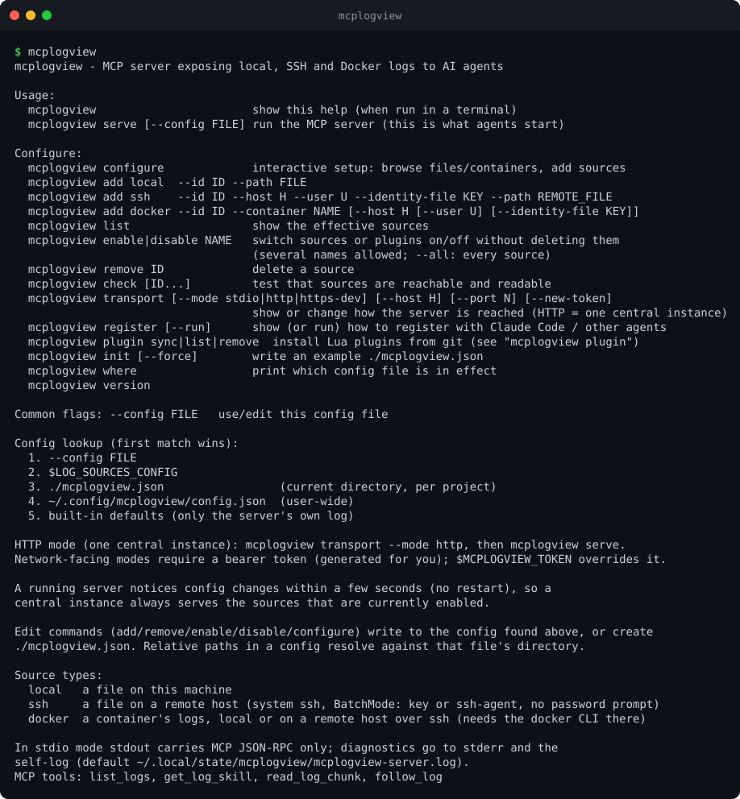

# Getting started

This takes you from nothing to an agent that can read one of your logs.

## 1. Install

```bash
# Linux / macOS (amd64, arm64): installer script
curl -fsSL https://raw.githubusercontent.com/skromesch/mcplogview-go/main/install.sh | sh
# or
brew install --cask skromesch/tap/mcplogview      # once a release is published
# or
go install github.com/skromesch/mcplogview-go/cmd/mcplogview@latest
# or from a checkout
go build -o mcplogview ./cmd/mcplogview
```

The installer script downloads the release archive for your OS and CPU from GitHub, verifies its SHA-256 against
the release's `checksums.txt`, and puts `mcplogview` into `~/.local/bin` (or `/usr/local/bin` when run as root). It
tells you if that directory is not on your `PATH`. Options:

```bash
curl -fsSL https://raw.githubusercontent.com/skromesch/mcplogview-go/main/install.sh | sh -s -- --version v0.1.0 --dir /usr/local/bin
```

`MCPLOGVIEW_VERSION` and `MCPLOGVIEW_INSTALL_DIR` do the same as the flags. Running it again upgrades in place.
Windows: download the `.zip` from the [releases page](https://github.com/skromesch/mcplogview-go/releases).

Check it works:

```bash
mcplogview version
```

## 2. Look around

Run it with no arguments **in a terminal** and it prints its help:



This is deliberate: when an *agent* starts `mcplogview` it talks over a pipe, not a terminal, and the same
command starts the MCP server. To start the server yourself use `mcplogview serve`.

## 3. Add your first log

The easiest way is the interactive setup:

```bash
cd ~/work/myproject
mcplogview configure
```


Pick **This project** (the config is stored as `./mcplogview.json`), then **Add a source** and browse to a
log file. [Interactive setup](interactive-setup.md) shows every screen.

Prefer one command? This does the same without any prompts:

```bash
mcplogview add local --id app --path logs/app.log --label "App log"
```

Check that it works:

```bash
mcplogview check
```

## 4. Connect an agent

Run this **inside the project directory**. The agent then starts mcplogview there, which picks up
`./mcplogview.json`:

```bash
claude mcp add mcplogview -- mcplogview
```

`mcplogview register` prints the exact command (and the JSON snippet for other MCP clients such as Claude
Desktop or Cursor). `mcplogview register --run` runs it for you.

Then ask the agent something like *"list my logs and show me the recent errors in the app log"*. It will call
`list_logs`, `get_log_skill` and `read_log_chunk` (see [Using it with agents](using-with-agents.md)).

## Where does the config live?

mcplogview looks for a config in this order and uses the first it finds:

1. `--config FILE`
2. `$LOG_SOURCES_CONFIG`
3. `./mcplogview.json` in the current directory, so each project can carry its own sources
4. `~/.config/mcplogview/config.json`, a user-wide fallback
5. built-in defaults (only the server's own log)

`mcplogview where` tells you which one is in effect.

## What next?

- Add SSH hosts and Docker containers: [Log sources](sources.md)
- One shared instance for a whole team: [HTTP mode](http-mode.md)
- Every setting: [Configuration reference](configuration.md)
