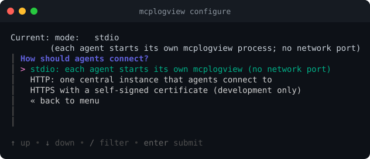
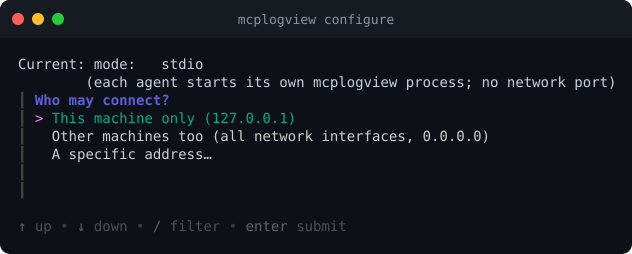
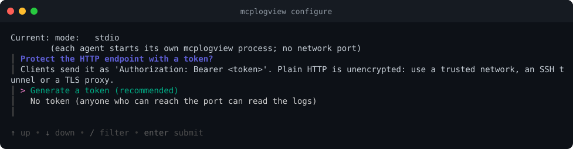
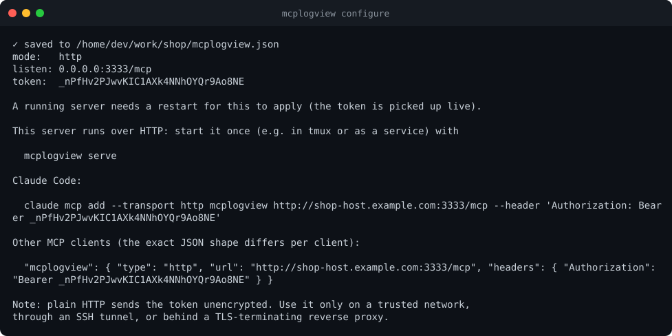
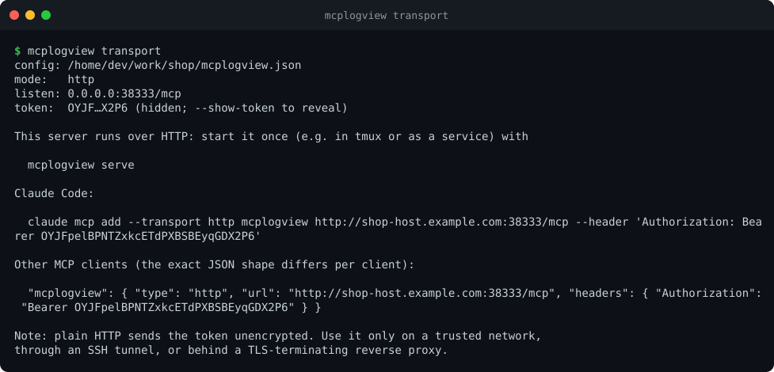
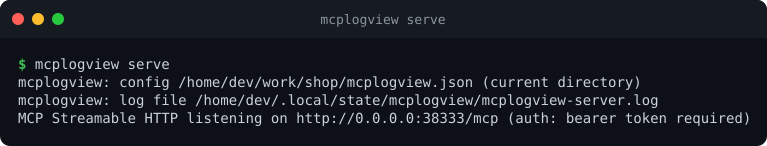
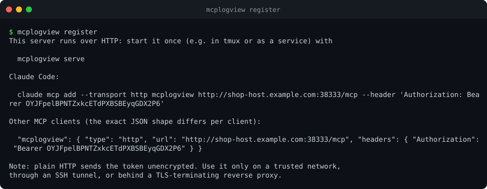

# HTTP mode: one central instance

By default every agent starts its own `mcplogview` over **stdio**. That is simple and needs no network. In HTTP mode
you instead run **one shared instance** that many agents (and many people) connect to. Use it when you want:

- one place that decides which logs are visible (see [switching sources on and off](sources.md#switching-sources-on-and-off)),
- SSH keys and Docker access on a single machine instead of on every laptop,
- agents that cannot start local processes.

It speaks **Streamable HTTP** on a single endpoint (default `/mcp`).

## Set it up

```bash
mcplogview transport --mode http --host 0.0.0.0 --port 3333
mcplogview serve
```

or use the wizard's **Server mode** menu:





`127.0.0.1` accepts only connections from the same machine; `0.0.0.0` (or a specific address) accepts the network.



Switching to HTTP **generates a token** for you. Clients must send it as `Authorization: Bearer <token>`.



Look at the current settings at any time (the token is hidden unless you pass `--show-token`):



Start the server (leave it running):



The last line says whether a token is required. The config file holds the token, so it is created with
permissions `0600` (owner only).

## Connect an agent

`mcplogview register` prints the right command for your setup:



For Claude Code:

```bash
claude mcp add --transport http mcplogview http://myhost:3333/mcp --header "Authorization: Bearer <token>"
```

For other clients add an HTTP server with that URL and header. The exact JSON shape differs per client; typically:

```json
"mcplogview": { "type": "http", "url": "http://myhost:3333/mcp",
                "headers": { "Authorization": "Bearer <token>" } }
```

## The token

| | |
|---|---|
| Generate / rotate | `mcplogview transport --new-token` |
| Show | `mcplogview transport --show-token` |
| Remove | `mcplogview transport --no-token` (on a non-loopback address this also needs `--allow-no-auth`, see below) |
| Set from the environment | `MCPLOGVIEW_TOKEN=...` (overrides the config) |

**Rotating needs no restart.** The running server re-reads the config every couple of seconds, so after
`--new-token` the old token stops working and the new one works. Clients then need the new token.

### The rules

- **A non-loopback address requires a token.** Without one `mcplogview serve` refuses to start:

  ```
  refusing to listen on 0.0.0.0 without an auth token: set one with `mcplogview transport --new-token` ...
  ```

  On a trusted network you can override this with `--allow-no-auth` (`allowNoAuth` in the config).
- On a loopback address (`127.0.0.1`) a token is optional, but switching to HTTP creates one anyway.
- Requests without a valid token get `401 Unauthorized`. The scheme must be `Bearer`.
- The token is compared in constant time and is never written to the self-log.

## Encryption

**Plain HTTP is not encrypted.** The token and the log lines travel in the clear. Use HTTP mode:

- on a network you trust, or
- through an SSH tunnel: `ssh -N -L 3333:localhost:3333 myhost`, then connect to `http://localhost:3333/mcp`, or
- behind a reverse proxy that terminates TLS (nginx, Caddy, ...). Keep mcplogview on `127.0.0.1` and let the proxy
  listen on the network.

`--mode https-dev` serves HTTPS directly. By default it uses a self-signed certificate generated at start-up (clients must be
told to trust it), or your own PEM files via `transport.httpsKey` / `transport.httpsCert`. It exists for
development; a proxy is the better production setup.

## Browser clients (MCP Inspector)

Browser-based clients such as the [MCP Inspector](https://github.com/modelcontextprotocol/inspector) are allowed
through CORS:

- **With a token**, any origin may connect, but it still needs the token. In the Inspector add the header
  `Authorization: Bearer <token>`.
- **Without a token** only pages from `localhost`, `127.0.0.1` and `[::1]` are allowed, so an arbitrary website cannot read
  your logs through your browser.
- Add specific origins with `transport.allowedOrigins` (`"*"` allows every origin).

[`examples/http-central.json`](examples/http-central.json), checked by the project's tests:

```json
{
  "transport": {
    "mode": "http",
    "host": "0.0.0.0",
    "port": 3333,
    "path": "/mcp",
    "authToken": "change-me-to-a-long-random-token",
    "allowedOrigins": ["https://inspector.example.com"]
  },
  "sources": [
    { "id": "app", "label": "App log", "path": "/var/log/myapp/app.log" }
  ]
}
```

## Changing things while it runs

| Change | Needs restart? |
|--------|----------------|
| add / remove / switch on or off a source | no, applied within seconds |
| skill files | no |
| the token | no |
| `mode`, `host`, `port`, `path`, `logging` | **yes** |

If you save a config that does not parse, the server logs the error to its self-log and keeps the previous sources.

## Keeping it running

The easiest way is Docker: the repository ships a hardened `compose.yaml`, see [Running in Docker](docker.md).
Otherwise mcplogview does not daemonize itself: run `mcplogview serve` under whatever you normally use
(`tmux`, a container, your own process supervisor). SSH keys and Docker access are those of the **user it runs as**,
and `docker` and `ssh` must be on its `PATH`.
