# Interactive setup (`mcplogview configure`)

`mcplogview configure` is a menu-driven editor for your config file. You never have to write JSON by hand,
but everything it does is also available as plain commands (see the [command reference](cli.md)).

**Keys:** arrow keys move, **Enter** chooses, lists filter **as you type**, **Ctrl+C** goes back to the menu
(from the menu it quits). Lists that need a choice always include a "back" entry as well.

If your terminal cannot show the interface, or input is piped, it falls back to simple numbered prompts
(force this with `--plain` or `MCPLOGVIEW_PLAIN=1`).

## The config file

If no config exists yet, the first question is where to put it:

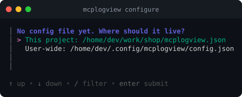

- **This project**: `./mcplogview.json`. Agents started in that directory use it.
- **User-wide**: `~/.config/mcplogview/config.json`. Used everywhere that has no project file.

If a config is found, it is edited in place and the header says which file it is. Only the parts the wizard
manages change; other keys in the file are kept.

## The main menu

Above the menu you see the file being edited and its sources: `[x]` means switched on, `[ ]` off.

## Adding a local file

Choose **Add a source**, then what you want to read:

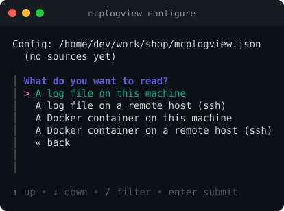

For files the browser starts in `/var/log` (set `MCPLOGVIEW_BROWSE_DIR` to start elsewhere). Folders end with
`/`, **[..]** goes up, and you can type a path yourself:

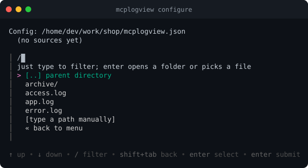

Start typing to filter the list:

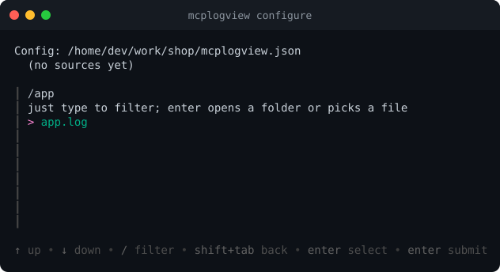

Press Enter on a file. Then name the source. The id is what agents use; the label, description and hint
help the agent (and you) understand what the log is. The fields are pre-filled with a suggestion, so clear
them first if you want something different.

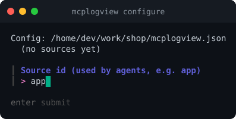

Before saving, mcplogview checks that the source can really be read:

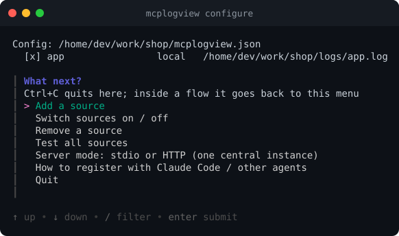

If the check fails you are asked whether to save it anyway (the default is no).

## Adding a Docker container

Choose **A Docker container on this machine**. The wizard lists all containers (running or not) from
`docker ps -a`:

Type to filter by name, image or status. Containers on another machine work the same way over SSH.

## Remote hosts over SSH

Choosing a remote file or container asks which host. The list comes from your `~/.ssh/config`, and
selecting one asks `ssh -G` for the user, port and key so you do not retype them:

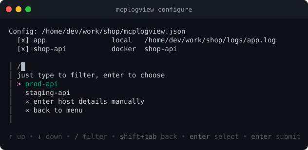

"Enter host details manually" asks for host, user, port and key file instead. mcplogview connects
non-interactively (`BatchMode`), so the key must work without a password prompt: use an unencrypted key or load
it into `ssh-agent`.

Pressing **Ctrl+C** in any step returns to the menu without saving anything:

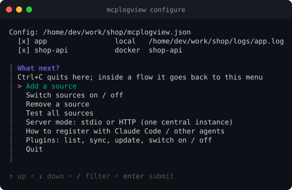

## Switching sources on and off

**Switch sources on / off** shows every source with a checkbox. Space (or `x`) toggles, Enter confirms:

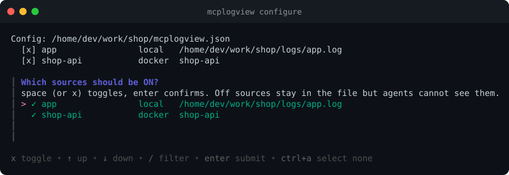

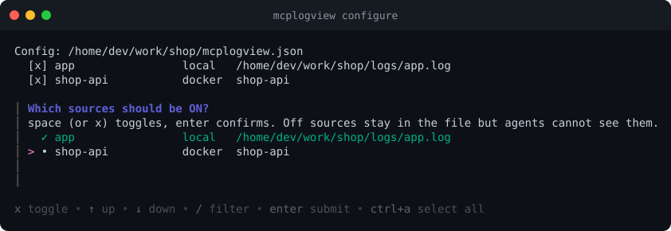

The menu header then shows `[ ]` for the source that is off:

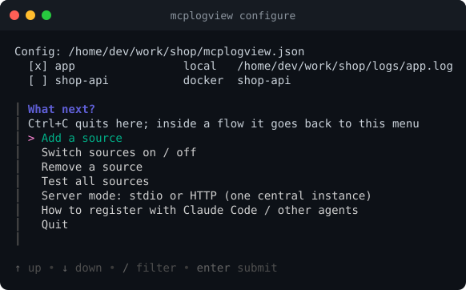

Switched-off sources stay in the file but agents cannot see them. A running server notices the change within a
few seconds, with no restart.

## Server mode: stdio or HTTP

By default each agent starts its own mcplogview process (**stdio**). **Server mode** switches to **HTTP**: one
central instance that agents connect to over the network.

A network-facing mode asks for a token. Generating one is recommended; running without is refused unless you
confirm:

When it saves, it prints the exact command to register the server with Claude Code:

More in [HTTP mode](http-mode.md).

## Testing and registering

- **Test all sources** reads each one and reports ok / FAIL with the reason (same as `mcplogview check`).
- **How to register with Claude Code / other agents** prints the registration command (same as
  `mcplogview register`).

## Plugins

**Plugins: list, sync, update, switch on / off** opens a sub-menu for the plugins in the config file
(see [Lua plugins](plugins.md)):

- **List** shows the same table as `mcplogview plugin list` (enabled, git@ref, locked and installed commit, state, load status).
- **Sync** runs `mcplogview plugin sync` for all plugins; **Update** runs `sync --update` for all or one chosen plugin.
- **Switch plugins on / off** works like the source toggle and sets `"enabled"` in the plugin entry, keeping the rest of it.
