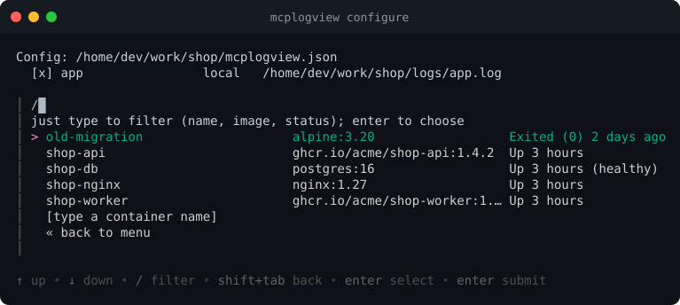
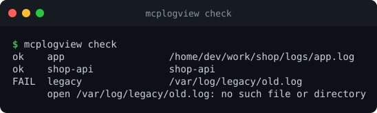
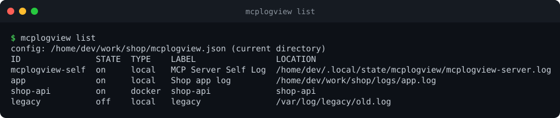

# Log sources

A *source* is one log an agent can read. There are three types. Agents see them through the same four
[tools](using-with-agents.md), whatever the type.

| Type | Reads | Needs |
|------|-------|-------|
| `local` | a file on this machine | nothing |
| `ssh` | a file on a remote host | the system `ssh`; a key or `ssh-agent` (no password prompts) |
| `docker` | a container's logs | the `docker` CLI, here or on the remote host |

Add one with [`mcplogview configure`](interactive-setup.md) or the commands below.

## Local files

```bash
mcplogview add local --id app --path /var/log/myapp/app.log --label "App log"
```

```json
{ "type": "local", "id": "app", "label": "App log", "path": "/var/log/myapp/app.log" }
```

Reading seeks straight to the position the agent last reached, so large files are fine. If the file is
replaced (log rotation) or truncated, reading restarts from the beginning of the new file.

## SSH files

```bash
mcplogview add ssh --id prod-api --host prod-api --user ubuntu \
    --identity-file ~/.ssh/id_ed25519 --path /var/log/myapp/api.log
```

```json
{ "type": "ssh", "id": "prod-api", "label": "Prod API log",
  "host": "prod-api", "port": 22, "user": "ubuntu",
  "identityFile": "~/.ssh/id_ed25519", "path": "/var/log/myapp/api.log" }
```

How it works:

- mcplogview runs the system `ssh` with `BatchMode=yes`: it never asks for a password or passphrase. Use a key
  without a passphrase, or load it into `ssh-agent`.
- `host` can be an alias from `~/.ssh/config`. `user`, `identityFile` and `port` are passed to `ssh` explicitly
  (`-i`, `-p`, `user@host`), so you do not depend on that config for them.
- On the remote side it needs a POSIX `sh` plus `wc`, `tail` and `head`.
- Each read transfers **at most 4 MiB** and always ends on a complete line; the agent continues from the cursor.
- A remote file that does not exist is reported as "remote log file not found".

**Security note.** `strictHostKeyChecking` defaults to `false`, i.e. an unknown or changed host key is
**accepted without verification**, which is convenient but open to man-in-the-middle attacks. For anything
important set it to `true` and connect once with plain `ssh host` first so the host key is in `known_hosts`.

## Docker containers

```bash
mcplogview add docker --id shop-api --container shop-api
```

```json
{ "type": "docker", "id": "shop-api", "label": "Shop API container", "container": "shop-api" }
```

mcplogview runs `docker logs --timestamps` for the container. Details:

- stdout and stderr are merged, and every line starts with Docker's timestamp (RFC 3339, nanoseconds).
- Stopped containers can be read too; the container just has to exist.
- Use the container **name** (or id). If the container is removed and recreated under the same name, the agent's
  position is reset and reading starts from the new container's first line.
- Needs the `docker` CLI and access to the Docker daemon (your user must be allowed to run `docker`).
- Each read is capped at 4 MiB (stdout and stderr together), always ending on a complete line.
- The container name is validated (`letters, digits, _ . -`) because it ends up in a shell command.
- Local Docker reading uses `sh`, so it is not supported on Windows.



**A container on another machine** is the same with a `host`; mcplogview then runs the docker commands there over
SSH:

```bash
mcplogview add docker --id prod-worker --container worker \
    --host prod-api --user ubuntu --identity-file ~/.ssh/id_ed25519
```

```json
{ "type": "docker", "id": "prod-worker", "label": "Prod worker container",
  "container": "worker", "host": "prod-api", "user": "ubuntu",
  "identityFile": "~/.ssh/id_ed25519" }
```

For `docker` sources `user`, `identityFile` and `port` are optional: left out, `ssh` uses your
`~/.ssh/config` for them.

**Chatty containers.** The Docker daemon records stdout and stderr lines from two goroutines, so a line can appear
in the log *after* a line with a newer timestamp. To never lose one, a read resumes about 250 ms before the last
timestamp it saw and drops what it has already delivered (remembered by hashes of the last 64 lines). On a
container logging hundreds of lines per second a resume can therefore repeat a few lines, but it will not skip any.

## Checking sources

```bash
mcplogview check            # all enabled sources
mcplogview check prod-api   # one source, even if it is switched off
```



`check` tests quickly that a source is reachable and readable without transferring log content. For SSH it
tests the connection and that the file exists and is readable; for Docker it asks the daemon whether the
container exists.

## Listing sources

```bash
mcplogview list
```



The first entry, `mcplogview-self`, is the server's own log (see [`logging`](configuration.md#logging)).

## Switching sources on and off

Keep every source you might need in one config and decide what agents may see, without deleting anything:

```bash
mcplogview disable prod-api staging-api     # hide from agents
mcplogview enable prod-api                  # show again
mcplogview disable --all
```

A disabled source stays in the file as `"disabled": true`. Agents cannot list or read it, and
`mcplogview check` skips it unless you name it. A **running** server picks the change up within a couple of
seconds, so a single central instance ([HTTP mode](http-mode.md)) always serves exactly what is switched on.
The same toggle is in the wizard under **Switch sources on / off**.

## Removing sources

```bash
mcplogview remove old-service
```
